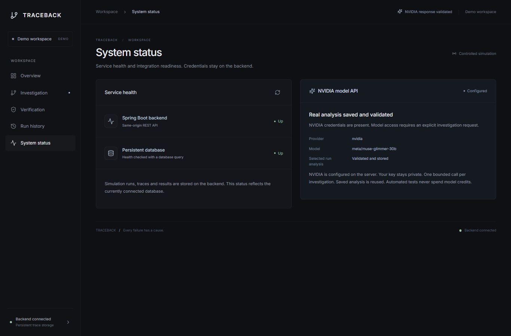
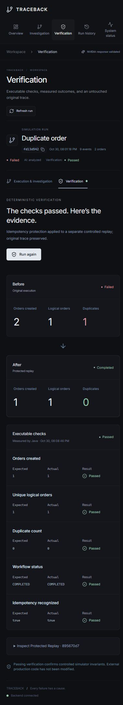

# TRACEBACK website audit and repairs

Date: 2026-11-03. Target: existing TRACEBACK, D:\TRACEBACK. Browser: in-app Chromium. Changes preserve the existing graphite design and stored run history.

| Step | Screen and flow | Final health | Checks and repairs |
|---|---|---|---|
| 1 | Overview and simulation dialog | Passed in tested flows | Real totals; new simulation; all five mobile navigation destinations visible; dialog Escape restores launcher focus. |
| 2 | Investigation and event inspector | Passed in tested flows | Fixed timeline rows painting over the footer; bounded scrolling at every breakpoint; full-width inspector; saved NVIDIA Event 7 selects the actual second order and scrolls into view; long identifiers and expandable metadata fit. |
| 3 | Verification and protected replay | Passed in tested flows | Original 2 orders to protected 1 order / zero duplicates; all checks visible as cards on phones; replay expands; newly created protected-timeout run also passes. |
| 4 | Run history and filtering | Passed in tested flows | No-match state and clearing filter work; table is keyboard-focusable and has a horizontal-scroll cue on phones; persisted runs reopen. |
| 5 | System status | Passed in tested flows | NVIDIA only in active setup; no Meta-key fallback while disconnected; configured state hides setup instructions; saved analysis and live server configuration have separate meanings. |

## Findings resolved

1. Timeline max-height combined with visible overflow caused lower event rows to paint into the footer and be clipped by the panel. Added actual vertical scrolling, keyboard focus and a separate footer.
2. A flex column inherited start alignment, making the inspector shrink on narrow screens. Stretching children restores the full panel width.
3. Offline backend state defaulted to Meta key guidance despite NVIDIA configuration. The UI now gives a connection state; setup is NVIDIA-only and shown only when needed.
4. Mobile navigation hid later destinations sideways. All five now fit as a compact grid. Headers wrap without squeezing titles against actions.
5. Mobile verification clipped result columns. Each measured check becomes a labeled card; desktop remains a table.
6. Retry refreshed summaries but could leave a deep-linked run unloaded. It now reloads the selected run; successful refresh clears the connection warning. Previous-run success notices are cleared on a different run load.
7. Deployment had separate development frontend/backend. Release packaging now serves both from Java, with private NVIDIA configuration and optional local / mandatory production shared demo authentication.
8. An abrupt-restart smoke test found delayed H2 writes. Synchronous production commits fixed it; run and verification survived the repeated abrupt stop.

## Evidence and limits

All five screens were checked for horizontal page overflow at 320, 768, 1024 and 1366px (responsive-audit.json), plus visual checks at 390px. No page-wide overflow; timeline footer separated at every tested width. Representative desktop and mobile screenshots are linked below. Existing real model output was reused; no new generation requests were sent. New phone-created run: 292e021e-dae3-4176-a56d-e86915d02a07.

37 backend tests, 8 frontend tests, lint and production build passed. Production-profile HTTP smoke tests passed authentication, bundled assets, simulation/verification, cross-origin rejection and persistence across abrupt restart. The final packaged website was also opened directly at port 8080 and its saved real evidence navigation checked. Browser logs showed one historical Vite reconnect error during development restarts; no error entry for the final port-8080 website was observed.

These checks are representative functional and visual QA, not formal accessibility compliance or exhaustive browser/load/security testing. The demo gate is shared access, not per-user authorization. Docker engine is unavailable; its image build/start and public HTTPS deployment remain untested. See DEPLOYMENT.md before publishing.

## Screen evidence

- Step 1: [Desktop](01-overview-desktop.jpg), [phone](01-overview-mobile.jpg).
- Step 2: [Desktop](02-investigation-desktop.jpg), [phone](02-investigation-mobile.jpg).
- Step 3: [Phone checks](03-verification-mobile.jpg).
- Step 4: [Desktop](04-history-desktop.jpg), [phone](04-history-mobile.jpg).
- Step 5: [Desktop](05-status-desktop.jpg), [phone](05-status-mobile.jpg).

